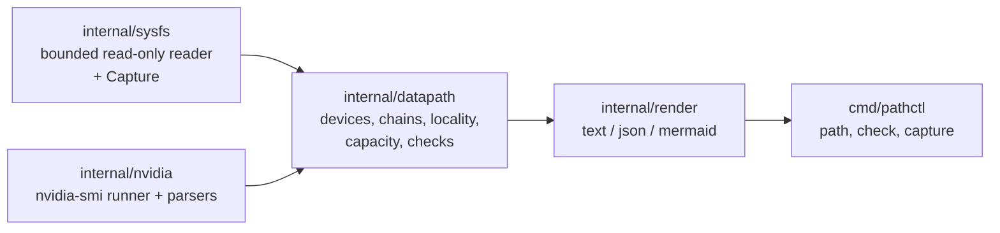

# Architecture

`pathctl` is one static binary made of four small packages. Data flows one
way, from the host to the screen, and nothing is inferred on the way.

## sysfs reader

`sysfs.Read(root)` takes an `*os.Root` and returns a `Host`: every PCI
function with its containment chain (root port down to the function), link
width and speed (current and maximum), NUMA node, AER counters, the parsed
configuration space, the `driver` and `physfn` links; the RDMA devices with
their ports; the network interfaces bound to a PCI function; the NUMA nodes
with their CPU lists.

Rules it keeps:

- Every path is resolved inside the root. The `bus/pci/devices` links are
  checked lexically and each component is `lstat`ed; nothing outside the root
  is opened. A fixture directory and `/sys` go through the same code.
- Every file is `stat`ed first and opened read-only with `O_NONBLOCK`; only
  regular files are read, and never more than the bound (4 KiB for attributes
  and the configuration space).
- A value that cannot be read keeps a status (`missing`, `permission`,
  `nodata`, `malformed`, ...) next to it. There is no default value.
- `Capture(root, dir)` writes the same read set into `dir` so that
  `Read(dir)` sees the same host later. It writes nothing into the root.

## nvidia-smi

`nvidia.Run(ctx, path)` runs the inventory query, `nvlink -s` and `topo -m`
with an absolute path, fixed arguments, a 5 s timeout and a 1 MiB limit on
stdout, in a minimal environment and without a shell. `nvidia.FromDir` reads
the same three outputs from a fixture. The parsers are tolerant of what they
do not understand: a line that is not a link state is skipped, a malformed
inventory row is reported and the rest is kept.

## datapath

`datapath.Build(source, host, outputs, options)` is a pure function that
produces a `Report`:

- Each PCI function becomes a `Device` with a role (gpu, nic, dpu, bridge,
  other) from the device table or the class code, and a `LinkState`: the
  negotiated link judged against the minimum of what the function and its
  parent port support. Below that minimum is degraded; a function that could
  do more than its parent is platform-limited, which is reported but is not a
  fault.
- Each GPU gets its chain of hops up to the root port, its NUMA node and CPU
  list, its identity from the inventory query, its NVLink state, and:
  - an `Attachment` per NIC/DPU with the locality derived from the two chains
    (same host bridge: `PIX` when the path crosses one switch, `PXB` when more,
    `PHB` when it crosses the root complex; different host bridges: `NODE` on
    the same NUMA node, `SYS` otherwise), the per-direction capacity of the
    slowest link on the path including the NIC port, and the `topo -m` verdict
    for the same pair when available;
  - a `Peer` per other GPU with the same locality, the NVLink count from
    `topo -m`, and for PCIe peers the switch ports whose ACS control redirects
    peer-to-peer traffic (P2P request redirect, completion redirect or egress
    control);
  - the checks listed in the README.
- Attachments are ranked: RDMA-capable before plain network, up before down,
  closer before farther, faster before slower. The first is the "best NIC"
  the checks judge.

Nothing in `datapath` touches files, the clock or the environment; the tests
build synthetic hosts and compare the full rendered output with golden files.

## render

Text is the primary output and is meant to be read on a terminal: a one-line
table of every GPU, then one block per GPU, then the limitations. JSON carries
the same content with stable field names. Mermaid draws the PCIe tree the
GPUs' paths touch, with NVLink peers as dashed edges.

## What was removed

The tree before `docs/plan/data-path-v2.md` held a Kubernetes control plane,
an mTLS ingest service, a fleet lifecycle state machine, a native PCIe
library and an offline explain tool, about 117,000 lines, none of it run on
real GPU hardware. It is preserved at the tag `legacy/v0-control-plane`. The
rules that made it robust (injected roots, bounded reads, unknown never
becoming a value, deterministic output) are kept here in about a twentieth of
the code.
